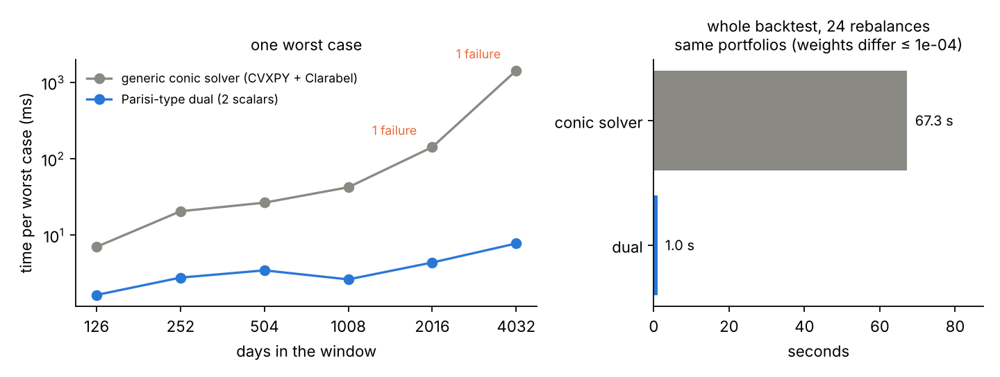
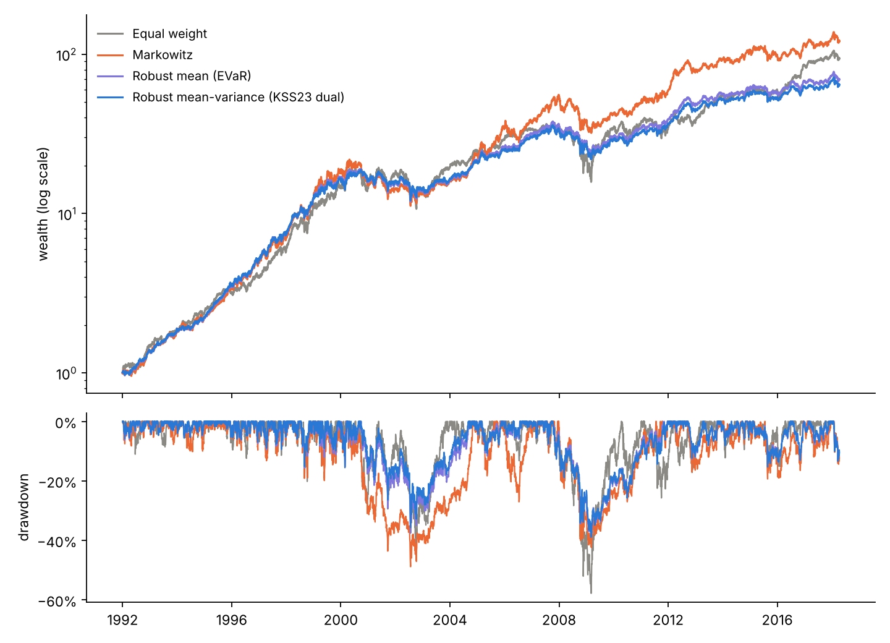
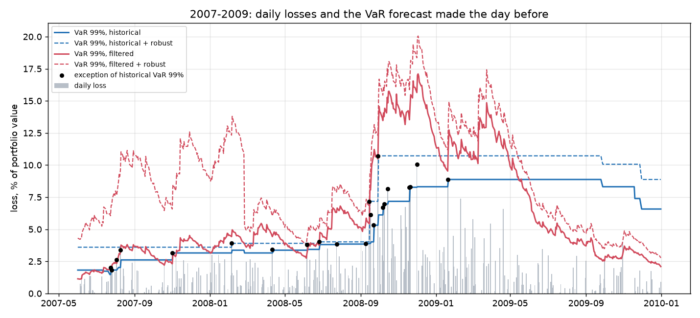

# kl-dro-spin-glass

From statistical mechanics to robust optimisation: the Parisi-type dual of a KL-constrained sup, an
educational desktop app, and a robust-portfolio case study on 28 years of real stock data.

## The idea

Free energies are a **sup** over probability measures; the Parisi formula is an **inf**. In REM-type
approximations of TAP free energies ([KSS23](https://doi.org/10.1088/1751-8121/acdf30)) the two are Lagrange
duals, and the Parisi parameter m is the price of an entropy budget. That is exactly how KL-robust
optimisation prices distrust in data: an adversary may reweight the data within a relative-entropy budget
ρ, and the worst case is a Gibbs measure. For a non-linear risk such as mean–variance, the worst case is
the inf over two numbers (q, m) of the Parisi-type formula.

## What is here

| part | what it is | where |
|---|---|---|
| Python package | both sides of the duality, checked against each other; the robust portfolio; spin-glass simulations | `src/tapdual/` |
| Desktop app | an educational tour in five sections, with live simulations and a glossary with formulas | `python -m tapdual.app` |
| Case study | KL-robust portfolios on real US stock prices, 1990–2018, with an honest reading | below, `results/backtest/` |
| Risk measurement | daily VaR, Expected Shortfall and EVaR with a model-risk (KL-robust) version, backtested | below, `results/risk/` |
| Live tracking | a virtual $10,000 followed every weekday by a GitHub robot, with a weekly report | `paper_trading/`, Issues |
| Tests | about 100 automated checks: duality, simulations, backtest, risk, app | `tests/` |

## Quick start

```bash
python3 -m venv .venv && source .venv/bin/activate
pip install -e ".[app,live,test]"
python -m tapdual.app          # the app
pytest                         # the checks
```

## The app

Each section opens with what we saw so far, what changes now, and the question it answers, and ends with
two or three references.

1. **What is a statistical-mechanics system?** Many simple parts, an energy, noise; energy and entropy
   demos; free energy as an optimisation.
2. **Order: Curie–Weiss.** A crowd makes up its mind on its own: phase transition, free-energy landscape,
   hysteresis.
3. **Disorder: spin glasses.** Random signs and frustration; SK (two replicas, Max-Cut) and the REM
   (freezing, the entropy budget).
4. **Memory: Hopfield networks.** Storage and retrieval; the same network as a restricted Boltzmann
   machine; storage capacity and what is still open.
5. **Robust decisions.** The worst case over a KL ball is a Gibbs tilt of the data; with mean–variance
   risk the sup becomes a Parisi-type inf over (q, m), checked live against a direct solution.
   - **5.1 Case study**: the results below, in plain words.
   - **5.2 Live**: today's portfolios and the virtual $10,000, from the latest prices.

## Case study: KL-robust portfolios on 28 years of US stocks

Walk-forward backtest on daily prices of 10 US stocks (1990–2018, including the dot-com crash and 2008):
every month each strategy is re-estimated on the last two years, long-only, with 10 bps costs. Settings
were fixed before looking at the results.

**The Parisi-type dual makes the robust portfolio 60–70× faster to compute.** The same robust
mean–variance backtest takes about 1 s with the dual and about 67 s with a generic conic solver
(CVXPY + Clarabel), with the same portfolios (weights differ by at most 10⁻⁴). One worst case costs a few
milliseconds whatever the window; the conic solver slows from 7 ms to 1.4 s as the window grows to 16
years, and occasionally fails to converge.



| strategy | annual return | volatility | Sharpe | max drawdown | turnover |
|---|---|---|---|---|---|
| Equal weight | 18.9% | 22.3% | 0.89 | −57.8% | 0.00 |
| Markowitz (mean − γ·variance) | 20.0% | 21.6% | 0.95 | −48.9% | 0.28 |
| Minimum variance | 15.6% | 16.9% | 0.94 | −38.5% | 0.07 |
| Robust mean (KL ball = EVaR) | 17.5% | 17.9% | 0.99 | −38.8% | 0.16 |
| **Robust mean–variance (KSS23 dual)** | 17.2% | 17.4% | 1.00 | −39.0% | 0.14 |



How to read it:

- **At the default budget, robust ≈ minimum variance.** Within a budget ρ the adversary can lower each
  asset's average daily return by about √(2ρ) standard deviations (0.3σ at ρ = 0.05 per day), far more
  than any real daily average. The averages then carry almost no information: the robust portfolio is
  minimum variance with a small tilt towards return.
- **ρ is a knob between Markowitz and minimum variance**: choosing it is choosing how much to trust past
  average returns. Along the whole range the Sharpe ratio stays at 0.98–1.00, a little above both ends:
  a modest gain, on one dataset. ([chart](results/backtest/sensitivity.png))
- **Exact and fast.** The worst case is an inf over two numbers instead of a sup over 504 day-weights; the
  portfolio gradient is read off the worst-case weights (Danskin's theorem).
- **Limits.** No clear performance edge over minimum variance; the mean–variance version performs like the
  linear one (EVaR), so its edge here is computational. Survivorship bias (well-known companies chosen
  today), zero risk-free rate, one dataset.

Full tables, crises and sensitivities: [`results/backtest/summary.md`](results/backtest/summary.md).
Reproduce with `pip install -e ".[backtest]"` and `python scripts/backtest.py` (about 10 minutes).
Data: [PyPortfolioOpt test prices](src/tapdual/data/README.md), MIT licence.

## Risk measurement with model risk

The same KL ball measures risk. The worst-case mean over a ball of radius log(1/(1−α)) is the **entropic
value-at-risk** (EVaR), an upper bound on Expected Shortfall; and the worst VaR or ES over a small ball around
the data is a **model-risk** version of the standard measures (as in Glasserman and Xu, *Robust risk
measurement and model risk*, Quantitative Finance 2014). Both are computed exactly: robust VaR by a Bernoulli
equation, robust ES by a minimax swap and the same one-dimensional dual (`src/tapdual/risk.py`).

Daily forecasts for the equal-weight portfolio, 1990–2018, each from the previous 250 days, backtested
with the tests risk teams use (Kupiec, Christoffersen, Basel traffic light, Acerbi–Székely for ES):

| VaR 99% method | exceptions (target 69) | in 2008 | clustering | ES 97.5%: Z2 (0 = right) |
|---|---|---|---|---|
| historical simulation | 94 | 16 | rejected | 0.29 |
| historical + robust (KL) | 27 | 4 | rejected | −0.43 |
| filtered by EWMA volatility | 90 | 4 | borderline (p = 0.02) | 0.12 |
| filtered + robust (KL) | 25 | 1 | rejected | −0.46 |



How to read it:

- **Historical simulation underestimates risk and reacts late**: a staircase that lagged the 2008 crash,
  with 16 exceptions that year instead of about 2.5.
- **Volatility filtering fixes the timing** (16 → 4 exceptions in 2008, no 250-day window in the Basel red
  zone), not the level.
- **The KL-robust adjustment fixes the level, and shows how little one year of data says about the tail.**
  With 250 days, VaR 99% is the third-worst day of the year; at a 95% confidence radius the model-risk bound
  is the worst day, which is too conservative (27 exceptions). A tenth of that radius (the second-worst day)
  gives the right rate (57–59 exceptions, Kupiec test passed).
- **Limit**: no distribution in the ball can put weight beyond the worst loss in the window; historical
  methods cannot imagine a crash worse than the ones they have seen.

Full tables and the sensitivity in ρ: [`results/risk/summary.md`](results/risk/summary.md). Reproduce with
`python scripts/risk_report.py` (about 2 minutes).

## Live tracking

A virtual $10,000 was invested at the close of 14 October 2026 in each strategy and in two benchmarks
(US stocks, 60/40 stocks/bonds), on nine ETFs, one per asset class. The workflow
`.github/workflows/paper-trading.yml` runs `scripts/track.py` every weekday after the US close: it updates
`paper_trading/virtual_report.md` and `virtual_values.csv` and, once a month, logs the portfolios to
`paper_trading/log.csv`. A weekly report is posted as an Issue. Educational, no real money, not investment
advice.

## Repository layout

```
src/tapdual/            model, gibbs, dual, primal   the duality (sup and Parisi-type inf)
                        dro.py                       KL-robust worst cases on data
                        backtest.py, live.py         case study, live tracking
                        risk.py                      VaR, ES, EVaR, model-risk versions, backtests
                        spinglass.py                 Curie–Weiss, Hopfield, SK, REM simulations
                        app/                         the desktop app, one file per section (s1_ ... s5_)
                        data/                        stock prices (PyPortfolioOpt, MIT)
scripts/                backtest.py, risk_report.py, track.py
results/                case study (backtest/) and risk report (risk/)
paper_trading/          the robot's records
tests/
```

## Papers

- N. Kistler, M. A. Schmidt, G. Sebastiani, *On the REM approximation of TAP free energies*,
  J. Phys. A: Math. Theor. **56** (2023) 294001. [arXiv:2212.11718](https://arxiv.org/abs/2212.11718)
- G. Sebastiani, M. A. Schmidt, *On the GREM approximation of TAP free energies*,
  J. Phys. A: Math. Theor. **57** (2024) 335206. [arXiv:2401.13507](https://arxiv.org/abs/2401.13507)
