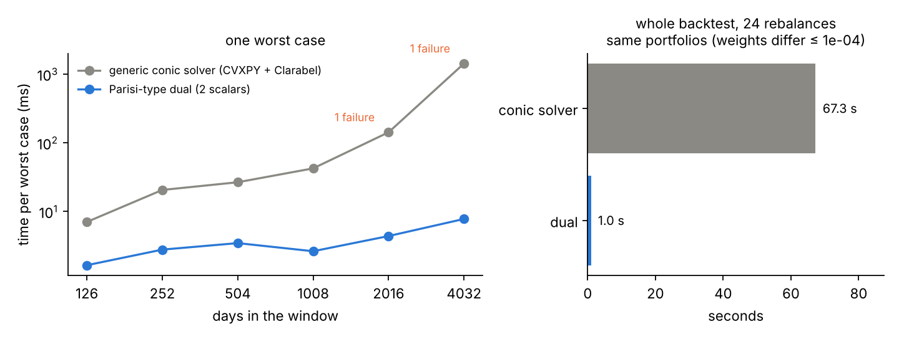
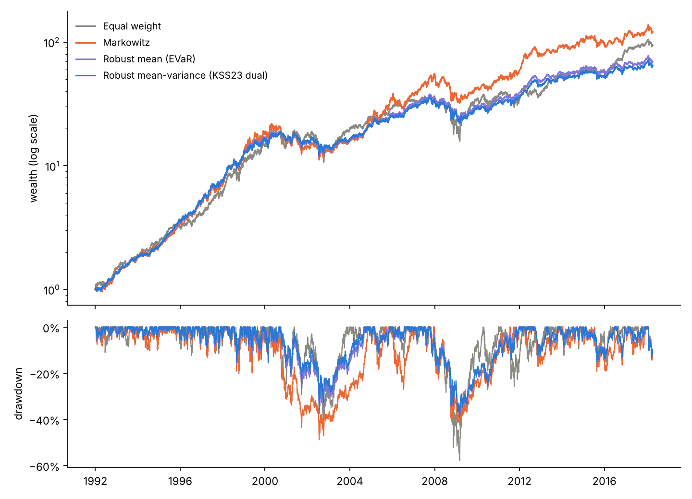
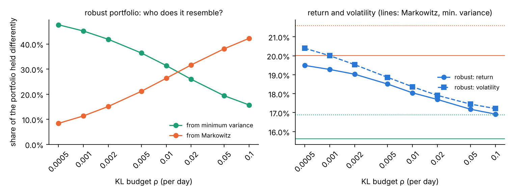

# kl-dro-spin-glass

From statistical mechanics to robust optimisation. A desktop app that tells the story order → disorder → memory → decisions (Curie–Weiss, spin glasses, Hopfield), and a Python package showing that for REM-type approximations of TAP free energies the Parisi formula is the Lagrangian dual of a KL-constrained sup, with a robust-portfolio backtest on 28 years of real stock data.

> Status: work in progress, built step by step.

## Outline (to be written)

1. The puzzle: free energies are naturally a **sup** over measures, yet for the
   SK model we only have an **inf** (the Parisi formula).
2. The ML/DRO view: KL-constrained worst-case expectations and their duals.
3. The REM/GREM approximation of TAP free energies: a non-linear model where
   both the sup and the inf are proved.
4. The dictionary: Parisi parameters as Lagrange multipliers.
5. Numerical primal-dual check and the phase transition.

## Case study: KL-robust portfolios on 28 years of US stocks

A walk-forward backtest on real daily prices of 10 US stocks (1990–2018, including the dot-com
crash and 2008). Every month each strategy is re-estimated on the last two years of returns,
long-only, with 10 bps transaction costs. All parameters were fixed before looking at results.

**Headline: the Parisi-type dual makes the robust portfolio 60–70× faster to compute.** The same
robust mean–variance backtest takes about 1 s with the dual and about 67 s with a generic conic solver
(CVXPY + Clarabel; timings vary a little between runs), and returns the same portfolios (weights differ
by at most 10⁻⁴). One worst case costs a few milliseconds whatever the window length; the conic solver
slows down from 7 ms to 1.4 s as the window grows to 16 years, and occasionally fails to converge.



*Left: time for one worst case (median of 5 random windows and portfolios; "failure" = Clarabel did
not converge and SCS was used instead). Right: the whole backtest over the last 24 monthly rebalances.*

The investment results:

| strategy | annual return | volatility | Sharpe | max drawdown | turnover |
|---|---|---|---|---|---|
| Equal weight | 18.9% | 22.3% | 0.89 | −57.8% | 0.00 |
| Markowitz (mean − γ·variance) | 20.0% | 21.6% | 0.95 | −48.9% | 0.28 |
| Minimum variance | 15.6% | 16.9% | 0.94 | −38.5% | 0.07 |
| Robust mean (KL ball = EVaR) | 17.5% | 17.9% | 0.99 | −38.8% | 0.16 |
| **Robust mean–variance (KSS23 dual)** | 17.2% | 17.4% | 1.00 | −39.0% | 0.14 |



What the robust portfolios do: an adversary may reweight the past days within a KL budget ρ, and the
portfolio is chosen against the worst reweighting. For mean–variance risk this inner worst case is the
non-linear problem of [KSS23](https://doi.org/10.1088/1751-8121/acdf30), solved through its Parisi-type
dual in two scalars (q, m); the portfolio gradient comes for free from the worst-case weights
(Danskin's theorem).

How to read the results:

- **At the default budget, robust ≈ minimum variance.** Within a KL budget ρ the adversary can lower
  each asset's average daily return by about √(2ρ) standard deviations: 0.3σ at ρ = 0.05 per day, far
  more than any real daily average. The averages then carry almost no information, and the robust
  portfolio behaves like a minimum-variance portfolio with a small tilt towards return. Its lower risk
  compared with Markowitz is mostly the lower risk of minimum variance.
- **ρ is a dial between Markowitz and minimum variance.** Small budgets keep the portfolio close to
  Markowitz, large ones push it to minimum variance; choosing ρ is choosing how much to trust past
  average returns. Along the whole dial the Sharpe ratio stays at 0.98–1.00, a little above both ends
  (0.95 and 0.94): a modest gain, on one dataset.
  
- **Exact and fast.** The sup over 504 day-weights becomes an inf over two numbers (q, m), and the
  portfolio gradient is read off the worst-case weights. It agrees with the conic solver to 10⁻⁸ and,
  unlike it, has no convergence failures on long windows.
- **Honest limits.** No clear performance edge over minimum variance; the non-linear (mean–variance)
  version performs like the linear one (EVaR), so its edge here is computational. Survivorship bias
  (well-known companies chosen today), zero risk-free rate, one dataset. The insensitivity to the risk
  aversion γ is a symptom of the KL term dominating, not a feature.

Full tables, crisis returns and sensitivities: [`results/backtest/summary.md`](results/backtest/summary.md).
Reproduce:

```bash
pip install -e ".[backtest]"       # pandas, matplotlib, cvxpy
python scripts/backtest.py         # about 10 minutes (most of it timing the conic solver); writes results/backtest/
```

Data: [`data/`](data/README.md), from PyPortfolioOpt (MIT licence).

## Paper trading with live prices

In the app, section 5 has three sub-pages in the sidebar:

- **5.1 Case study: real data**: the backtest above, explained in plain words.
- **5.2 Today: live portfolios**: downloads the latest prices when you open it and shows today's portfolios,
  the past days the robust portfolio protects against, and (once you save entries) what to buy and sell.
- **5.3 A virtual $10,000**: the first time you open it, invests a virtual $10,000 at the latest close in
  each strategy; every time you come back it shows what each is worth, day by day (monthly rebalancing,
  no look-ahead, 0.1% costs). Only the start date is saved (`paper_trading/virtual_portfolio.json`).

The same from the command line:

`scripts/today.py` downloads the latest prices from Yahoo Finance (free, via `yfinance`), computes
today's robust portfolio next to Markowitz and equal weight, shows the past days the worst case is
sized against, and appends the weights to `paper_trading/log.csv`. Run it once a month to build a real
out-of-sample record. Educational tool, not investment advice.

```bash
pip install -e ".[live]"
python scripts/today.py
```

Default universe: nine liquid ETFs, one per major asset class (US, developed and emerging stocks, US real
estate, medium/long US government bonds, corporate bonds, gold, commodities). There is deliberately no
cash-like fund: at the default budget the robust portfolio behaves like minimum variance (see the case
study), so with a near-cash fund available it would simply hold that. Window and settings
are the backtest's. Use `--tickers` to change the assets.

## Desktop app

A local Mac/Linux/Windows app that tells the story from statistical mechanics to
robust optimisation, with live simulations:

```bash
pip install -e ".[app]"        # adds PySide6, pyqtgraph and matplotlib
python -m tapdual.app
```

Each section opens with what we saw so far, what changes now, and the question it answers:

1. **What is a statistical-mechanics system?** Many simple parts, an energy, noise; Gibbs
   probabilities and summary numbers; energy and entropy demos; free energy as an optimisation.
2. **Order: Curie–Weiss.** A crowd makes up its mind on its own: phase transition, the
   free-energy landscape, hysteresis of adoption with peer effects.
3. **Disorder: spin glasses.** Random signs and frustration; SK (two replicas, Max-Cut) and the
   REM (freezing, the entropy budget).
4. **Memory: Hopfield networks.** Storage and retrieval; the same network as a restricted
   Boltzmann machine; storage capacity and what is still open.
5. **Robust decisions.** KL-constrained DRO on 756 daily returns: the worst case is a Gibbs
   tilt of the data with temperature λ, and freezes onto the worst days as the budget grows.
   With mean–variance risk the non-linearity is concave and the sup becomes a Parisi-type inf
   over (q, m), checked live against a direct solution of the sup; plus a physics ↔ DRO dictionary.

Each section ends with two or three references for further reading. Blue words open a glossary entry with typeset formulas (rendered offline with matplotlib).

## Dashboard

Two interactive pages in `docs/`, computed live in the browser by `docs/solver.js`,
a JavaScript port of the Python package (checked against it by
`scripts/check_dashboard.py`, which needs Node.js):

- **`docs/index.html`: the KL budget as a robustness radius (spin-glass model).**
  Sliders for β, h and the budget ρ; the worst-case distribution against the
  Gaussian, the Parisi function along the KKT path, and complementary slackness.
- **`docs/mean-variance.html`: robust mean-variance on a dataset.** The same duality
  applied to KL-DRO on data: an adversary reweights daily returns within a KL ball
  to maximise E ℓ + γ Var ℓ − τ KL. Sliders for γ, τ and ρ, and you can load your
  own CSV of returns (it stays in the browser).

Open either file in a browser; double-clicking works, no server needed.

## Python package

```bash
python3 -m venv .venv && source .venv/bin/activate
pip install -e ".[test]"
pytest
python -m tapdual sk --beta 5 --h 0.5                  # spin-glass model
python -m tapdual mv --gamma 1 --tau 0.5 --rho 0.1     # robust mean-variance, built-in data
python -m tapdual mv --csv my_returns.csv              # ... on your own returns (in %)
```

`pyproject.toml` describes the package for `pip`; there is no need to open it.

### Checks

- primal (sup over measures) = dual (Parisi inf) to ~1e-12, in both phases;
- the KKT conditions, the jointly convex coordinates (p, λ), and the transition;
- the classical REM threshold β_c = √(2 log 2) is reproduced to 1e-8;
- on data, a direct optimisation over all sample weights gives the same value
  as the two-parameter dual.

## Papers

- N. Kistler, M. A. Schmidt, G. Sebastiani, *On the REM approximation of TAP free
  energies*, J. Phys. A: Math. Theor. **56** (2023) 294001.
  [arXiv:2212.11718](https://arxiv.org/abs/2212.11718)
- G. Sebastiani, M. A. Schmidt, *On the GREM approximation of TAP free energies*,
  J. Phys. A: Math. Theor. **57** (2024) 335206.
  [arXiv:2401.13507](https://arxiv.org/abs/2401.13507)
